# ShiroMoto Garage

**ShiroMoto Garage** is the booking system for a car and motorcycle repair shop. Customers book a service, like a PMS, an oil change or new brake pads. The shop gives each job a free **bay** and a free **mechanic** with the right skill. Nobody can book the same bay or the same mechanic twice at the same time.

I made this project to practice three skills: **date and time handling** (opening hours, lunch breaks, holidays and leave), **transactions** (a booking is saved all at once, or not at all) and **concurrency** (two people who press "Book" at the same second can't both get the last slot).

It was built in 8 stages (the plan is in `docs/PLAN.md`). It also installs on a phone like an app.


## Who Uses It

**Try it:** press **Try Demo** on the login page. You get a private sample shop with 7 bays, 4 mechanics, 16 services (two of them Other Services), parts, four weeks of history, a car waiting for its owner's approval, and a price for Carlo to confirm. It is yours alone, and it is deleted after 2 hours. **View as** (at the top) lets you see the shop as the service advisor, a mechanic or Carlo, a customer.

| Role | Can do |
|---|---|
| Owner | Everything, including the shop's Settings, parts and Insights |
| Service advisor | The front desk: bookings, walk-ins, check-in, customers, parts, waitlist |
| Mechanic | Their jobs, the calendar and their own week |
| Customer | Book (as a guest or with an account), ask for a service that isn't listed, ask for a new time, cancel, approve prices and estimates, My Garage |

## The Shop's Pieces

```
Service (Car PMS, 3 h)  ──needs──►  a kind of bay (Car lift)  +  a skill (Engine)
                                          │                          │
                                     Lift 1, Lift 2            Jun, Ana (mechanics)
```

- A **bay** holds one vehicle at a time: a car lift, a car bay, an alignment bay or a motorcycle stand.
- A **mechanic** has skills (Engine, Brakes, Electrical, Aircon, Tires, Motorcycle) and working hours.
- A **service** says which kind of bay and which skill it needs, how long the work takes, and the clean-up time after it.
- Work time skips the lunch break. A 3-hour job that starts at 10:00, with lunch from 12:00 to 1:00, ends at 2:00.

## Setting Up the Shop

**The shop's page** (for everyone)
- The home page: services and prices for cars and for motorcycles, opening hours, today's status ("Open 8:00 AM to 5:00 PM" or "Closed: Bonifacio Day") and the closures in the next 30 days.

**Settings** (for the owner)
- **Shop details and booking rules:** the earliest and latest booking, the online cancel cut-off, and how long a chosen time is kept.
- **Opening hours:** each day of the week, with a lunch break. Times use 15-minute steps.
- **Closures and leave:** shop closures, part-day closures (for example 1:00 to 5:00 PM for training), and a mechanic's leave. **Add PH holidays** adds the Philippine holidays for a year. Holy Week is worked out for each year, because Easter moves.
- **Bays:** add, rename, or take a bay out of use. Add new kinds of bay.
- **Services and prices:** time, clean-up, bay, skill and price. Prices are saved as whole centavos, never as decimals. Customers see each price as an estimate ("from ₱3,500"). The final price comes from the estimate they approve after the check.
- **Staff:** invite a service advisor or mechanic with a one-time link, change roles, set skills and working hours, and switch off a login.

## How Available Slots Are Found

A time is free when **a mechanic with every skill** is working for the whole job **and a bay of the right kind** is empty for the whole job.

```
Shop hours        8:00 ─────────── 12:00   lunch   1:00 ──────────── 5:00
Jun's hours       8:00 ─────────── 12:00           1:00 ──────────── 5:00
Car PMS (3 h 15 min with clean-up), starting 10:00:
                        10:00 ════ 12:00 (pause)   1:00 ═══ 2:15  ready
```

- Every time is in **minutes since midnight** on the shop's clock (8:30 AM is 510). The finder adds, subtracts and compares plain numbers. Only the final start becomes a real UTC moment.
- **Work time skips breaks.** A job never starts during lunch, and it must finish before closing on the same day.
- **Closures:** Sundays, holidays and whole-day closures give no times. A part-day closure (1:00 to 5:00 PM) cuts the afternoon.
- **People:** a mechanic's own hours, days off and leave (a whole day, or only part of it) count too. Ana is off on Mondays, so on Mondays there are no Aircon times.
- **Booking rules:** the minimum notice (2 hours: at 9:10 AM the first time is 11:15 AM), the furthest day (30 days ahead), and "today" means **Manila's** today. At 11:30 PM in UTC, Manila is already the next morning.
- **Several services in one visit** add up their work time. The clean-up happens once, at the end. They must use the same kind of bay: a car is not moved from the lift to the alignment bay halfway through.
- When a day has no times, the page says why: "Closed: Bonifacio Day", "No mechanic who does this works on this day", "The times left on this day are too soon to book"...

**The Book page** (customers): choose the vehicle, then the services, then a day. The strip shows how many times each day has. Every step is in the web address, so it can be shared.

**Available Slots** (staff, in the menu) is not a booking page. It lists only what's still open: for each mechanic (or each bay), its slots, like "8:00 AM – 12:00 PM", and how much free time that is. A slot is a stretch of at least 30 minutes (the shortest service) with no booking, held time, break or leave. Each day in the strip says how many slots it has, like "9 slots available". To book from it, press a slot (or **Book a walk-in or caller**): the booking page opens on that day. That page also shows which mechanics and bays each start time would use.

## How Double Booking Is Stopped

A booking takes **cells**: one row for each 15 minutes, for its bay **and** for its mechanic. The database has one rule on those rows: the same bay (or mechanic) and the same 15 minutes may appear only once.

```
booked_slots                       UNIQUE (resource, slot_start)
bay  Lift 1   8:00  ── booking SM-7K3QD
bay  Lift 1   8:15  ── booking SM-7K3QD
mech Jun      8:00  ── booking SM-7K3QD      a second booking of Lift 1 at 8:00
mech Jun      8:15  ── booking SM-7K3QD      is refused BY THE DATABASE
```

**A race.** Two people press 9:00 at the same second:
1. Both see 9:00 free, and both try to write their cells.
2. The first one is saved.
3. The second one breaks the rule. Its whole transaction is undone, so nothing is half saved.
4. It looks at the day again. It takes another bay or mechanic if one is free at 9:00. If not, it says "That time was just taken" and shows the times that are still free.

The tests do this for real: 10 threads press the same time at once. With one lift, exactly 1 wins. With two lifts and two mechanics, exactly 2 win.

**More safety:**
- **Holds.** Pressing a time keeps it for 5 minutes while you type your details (the cells belong to the hold). A hold that runs out stops counting, and the next person can take the time.
- **One booking per press.** The form carries a one-time key, so a double-click or Back + Book makes one booking, not two.
- **One transaction for each change.** Booking, moving and cancelling each save everything or nothing. Moving frees the old cells and takes the new ones together.
- **Nobody overwrites anybody.** Every booking has a version number. If the shop moves your booking while your page is open, your page's old Cancel is refused ("Someone else changed this booking").
- **On PostgreSQL** (the live site) there are two more locks:
  - the request locks the bay and mechanic rows first (`SELECT ... FOR UPDATE`), so the second request waits for the first;
  - an exclusion constraint refuses any two bookings whose times overlap on one bay or one mechanic.

**For customers:**
- Book as a **guest**: you get a booking number (like SM-7K3QD) and a private **link**. The link opens your booking from any phone, so you can ask for a new time or cancel it. The browser remembers it too.
- **Add to calendar:** an .ics file with Manila time and a reminder the evening before.
- **Ask for a new time or cancel online** until 12 hours before (the owner sets this). After that, call the shop. A new time needs the shop's OK (see below).
- **An account (My Garage)** keeps your vehicles and bookings together and fills in the form for you. Open a guest booking's link while logged in, then press **Save to My Garage**.
- **My Garage is the customer's dashboard** and their start page (the phone app opens it too). At the top: the next visit, what's in the shop, and the next service due. Under them, **Needs Your Answer** lists estimates and prices waiting for them. Then the vehicle in the shop, coming bookings, vehicles, and past visits (folded away).
- The customer's menu is just **My Garage, Book, Services, Settings**. The shop's hours are on the Services page, so they don't need a button of their own.

**For staff:**
- **Available Slots** shows what's still open, and **Book a walk-in or caller** books from it.
- **Today** lists the day's bookings. A mechanic sees their own jobs.
- Staff can open any booking and cancel it at any time. To move it, they propose a new time and the customer accepts it (see below). They also answer customers' move requests.

## The Front Desk

- **Today** is the desk's to-do page:
  - three tiles for the shop's hours (and the next closure), the day's bookings, and who's in;
  - **Needs an Answer**: move requests and Other Service prices, in one list. **Red** means the shop must act (a new time to answer, a price to send); **blue** means the shop is waiting for the customer;
  - **the queue**, with **Check in** (with the odometer reading) and **No-show** buttons.
- **Calendar** is **the floor**: one row for each bay (or each mechanic), one column for each 15 minutes, with the bookings, the times someone is booking right now, lunch, and a red line for "now". Today doesn't repeat it.
- **No-show:** after 15 minutes the front desk can mark a no-show. The rest of that booking's time is freed at once, so a walk-in can have the bay. If the customer comes after all, **They came** takes the time back. But if a walk-in was already booked into it, the database refuses and nothing changes.
- **Walk-ins and callers:** staff book from **right now**. The customers' 2-hour notice is only for online bookings.
- **Calendar:** any day as the floor (by bay or by mechanic), or a whole week.
- **Bookings:** every booking. Search by booking number, name, phone (written any way) or plate, and filter by status, who booked and dates.
- **Customers:** everyone who booked, with their vehicles, visits, no-shows and the shop's private notes.
- **A booking's page** keeps everything in one card: the details, then Add to calendar and Move, then Check in and No-show for the desk, then **Cancel this booking** (folded away until you need it).
- Mechanics see Today (their own jobs), the Calendar, Jobs and Available Slots. The owner and service advisors see everything.

## Jobs, Estimates and Parts

Check-in opens a **job**. It moves along one road, and each step is written on a timeline the customer can read:

```
Checked in → Inspecting → Waiting for approval → In progress → Ready for pickup → Released
                                                    ↕
                                            Waiting for parts
```

- **Check-in checklist:** fuel level, body, glass, lights, tires, warning lights and items left inside, plus **photos**. Every photo is made smaller and saved as WebP, and its hidden camera data (like the GPS position) is removed.
- **Estimates:** during the job, staff add **a service from the shop's list** (its name and price fill in), other work, or a part, with a reason in plain words. The job goes to **Waiting for approval**, and the customer gets a message listing each item and its price. They **approve or decline each line** from their booking link. The shop only does what was approved, and the job can't be "Ready" while a line is waiting.
- **Only one decision counts.** A line changes only while it is still "waiting" (`UPDATE ... WHERE status = 'proposed'`). If the customer and the front desk press at the same moment, the second one is told it was already decided.
- **Parts and stock:** an approved part is taken from stock **in the same transaction** with `stock = stock - n WHERE stock >= n`, so stock never goes below zero. If two jobs want the last brake pads at once, one gets them and the other goes to **Waiting for parts**. When the delivery comes, "The part is here" takes it. Every change is in the part's history, and there is a **low-stock** list. Each low part has an **Order** button with a suggested amount (enough to reach twice its "order at" level), which opens the part's Receive form with that amount filled in.
- **Vehicle history:** every visit, the odometer and the extra work. **Next service due** says "after 6 months or 5,000 km, whichever comes first" (the owner sets this per service). It is also in the customer's My Garage.
- **Jobs board:** every vehicle in the shop, by step. A mechanic sees their own jobs first.

## Asking for a New Time

A booked time never changes without both sides agreeing. Whoever wants the new time **asks**, and the other side **accepts or declines**.

**When the shop needs to move a booking**, staff press **Propose another time** and pick one. Then:
- the customer gets a message: "Can we move booking SM-...?", with the shop's note;
- the new time is held for them, and **the booking stays where it is** until they answer;
- they press **Accept the new time** or **Keep my time** on their booking (My Garage lists it under **Needs Your Answer**);
- a customer with no email or account is called, and staff record the answer with **They said yes** or **They said no**;
- if the customer already agreed on the phone or at the desk, **They agreed: move it now** moves it at once;
- the desk and the booking's mechanic hear the answer. If nobody answers before the time runs out, the desk is told to call them.

**When the customer wants a new time**, it works the other way round:

1. On their booking, the customer presses **Ask for another time**, picks a day and time, adds a note if they like, and presses **Send the request**.
2. **The new time is held for them** (up to a day, and never past its own start), so nobody else can book it while the shop decides. **The booking stays at its current time** until then. They can **withdraw** the request.
3. The desk sees **Move Requests** on Today. The mechanic of that booking and the owner and advisors get a notice. The booking page shows both times, the customer's note, and which mechanic and bay the new time would use.
4. **Approve the new time** moves the booking, or **Decline** keeps it as it was. Staff can add a note either way, and the customer gets a message. If nobody answers in time, the request **runs out**: the held time is given back and the customer is told.

**How it stays safe:**
- **Approving is one transaction.** The old time's cells are deleted, the held cells become the booking's (with a count check), the booking gets the new time, bay and mechanic, and the hold is deleted.
- **Every answer is claimed first** with `UPDATE ... WHERE move_status = 'asked'`. So Approve and Withdraw pressed at the same moment can't both count (a thread test checks this 5 times).
- **Asking twice at once** (two tabs) makes one request. The second ask's claim fails, and its held time is given back.
- Cancelling the booking, or staff moving it themselves, ends a waiting request and gives its held time back.

## A Service That Isn't on the List

Every vehicle has an **Other Service** at the end of its list, for work the shop doesn't list (like "the horn stopped working").

1. The customer writes **what they need** and books a time, like any other service. The time is the Other Service's own working time (1 hour to begin with), so the shop has time to check it. Its price says **Price after we check**.
2. On **Today**, the desk sees **Other Services to Price**. The owner, a service advisor or a mechanic opens the booking, writes the price and a short note, and presses **Send the price**. The customer gets a message by email and on their phone (if they turned it on).
3. The customer opens their link and presses **Confirm** or **Decline**. My Garage shows **Price to confirm** until they answer.
   - **Confirm:** the price becomes part of the booking.
   - **Decline:** the Other Service comes off the booking, and the booking gets shorter. If it was the only service, the booking is cancelled, and its time is free for someone else.
   - The desk gets a notice either way. A customer who calls can tell the desk, and the desk records the answer.

**Only one answer counts.** The answer is one `UPDATE ... WHERE quote_status = 'priced' AND quote_price = <the price the customer saw>`. So a double tap counts once, Confirm and Decline pressed at the same moment can't both win (a thread test checks this 5 times), and if the shop changed the price a moment before, an answer to the old price is refused and the customer sees the new one.

The owner can change the Other Service's time, bay and skill in **Settings → Services and Prices**, or turn it off by unticking "Customers can book it".

## Notices, the Waitlist and the Phone App

**Notices.** Customers get a message when they book, when the shop answers their move request, when a booking moves or is cancelled, the evening before (from 5 PM), when there's an estimate to approve, when the vehicle is ready, and a week before a PMS is due. The front desk gets a push notice for each new online booking.
- **Email** goes through Gmail with an app password. **Push** goes to phones that turned it on.
- Every notice goes into an **outbox** first, with a unique key. The same reminder can't be queued twice, even if the timer runs twice at the same moment.
- Before sending, a notice is **claimed** ("pending" becomes "sending"), so two timers never send the same email twice.
- A failed email is tried again 3 times.
- Links in notices are **signed** by the app, so they open the customer's booking without the app keeping their secret link.

**The timer.** Render's free plan has no timer. So a free **GitHub Actions** schedule (`.github/workflows/tick.yml`) calls `/tasks/tick` every 15 minutes with a secret key. Each call clears held times that ran out, makes waitlist offers, queues reminders and sends what is due.

**The waitlist.** On a full day, a customer can **join the waitlist** for a range of days. When a time frees up (a cancellation, a no-show, a moved booking), the first person waiting is offered it:
- the time is **held for 30 minutes**, so nobody else can take it, and they get a link;
- if they don't take it, it goes to the next person (up to 3 offers each).

At the desk, each offer shows a thin bar that drains over its 30 minutes, so you can see how long the customer has left.

The offer is claimed with a conditional update, so two timers never offer the same person two times.

**The phone app.** The site installs like an app (a PWA):
- **Install** in Settings on Android, or **Share → Add to Home Screen** on iPhone;
- its own icon, it opens full screen, and an **offline** page when there's no signal;
- **push notifications** on the phone.

On iPhone, push works after installing the app (iOS 16.4 or newer).

## Insights

For the owner, over the last 7, 30 or 90 days:
- **Tiles:** bookings, expected money (the booked services' starting prices plus the extra work customers approved), work done, bay use, the no-show rate and the cancel rate.
- **Bookings per day** (columns), and **busiest hours** (a weekday × hour grid: a stronger colour means busier).
- **Bay use:** booked time as a share of the open hours, without breaks and closed days, per bay.
- **Money by service and by mechanic**, how people booked (online, phone, walk-in), and why bookings were cancelled.
- Every chart has a **Show as a table** view, and a small tip on hover. The colours were checked with a colour validator for both light and dark mode. Dark mode has its own steps: there, a busier hour is lighter.

## Safety

- Passwords are saved only as hashes. After 5 wrong tries, the account waits 15 minutes.
- An invite link works once, for 7 days. Only a hash of it is saved.
- A booking opens only with its private link, for its customer, or for staff. Everyone else gets "not found".
- Every page is protected against forms sent from other sites (CSRF), and the browser may only run the site's own scripts (a Content Security Policy).
- Check-in photos lose their hidden GPS data, and only staff and the booking's customer can see them.

## Pictures

**Booking (customers)**

| | |
|---|---|
|  The shop's page |  Book: choose services |
|  Book: free times |  Your details (the time is kept) |
|  A booking's page |  The customer approves an estimate |
|  My Garage |  Join the waitlist |
| 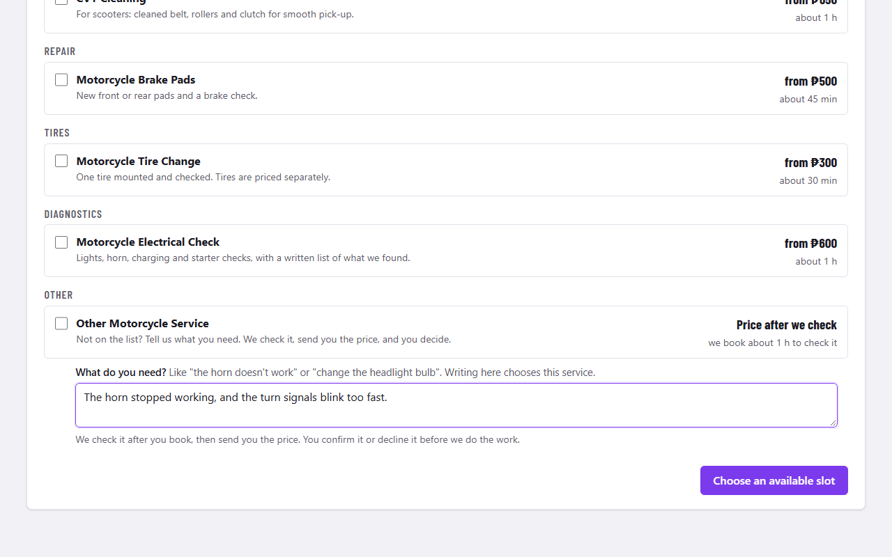 Other Service: write what you need | 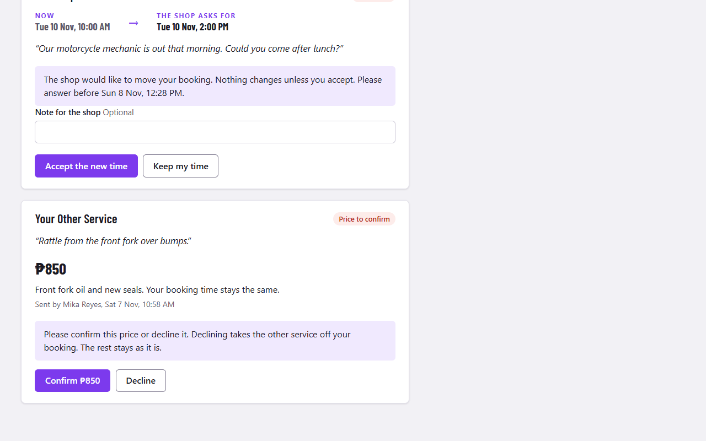 The customer confirms the price |
| 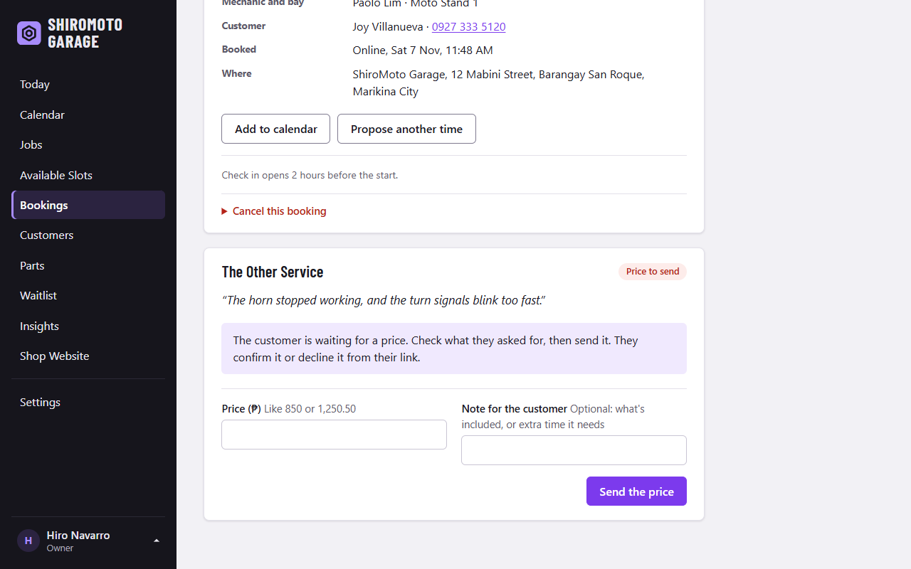 Sending the price (staff) | 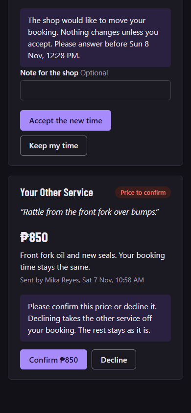 The price on a phone, dark mode |
| 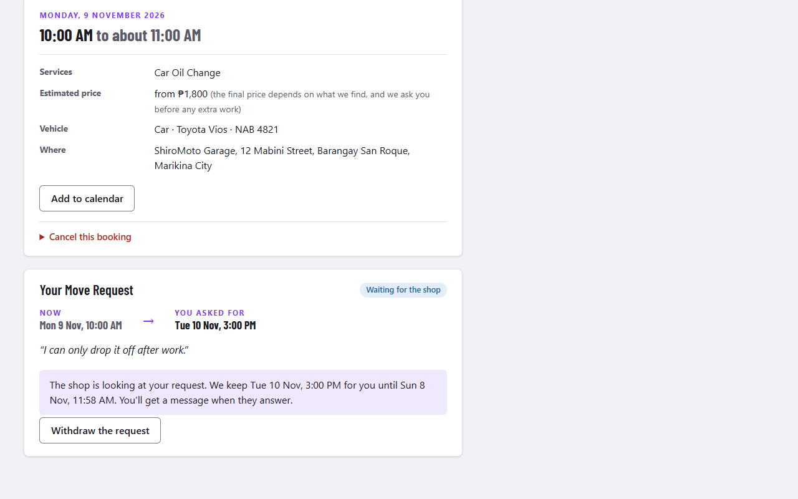 A move request, waiting for the shop | 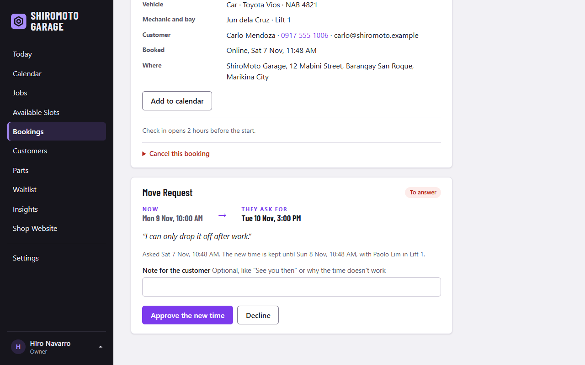 Staff approve or decline it |
| 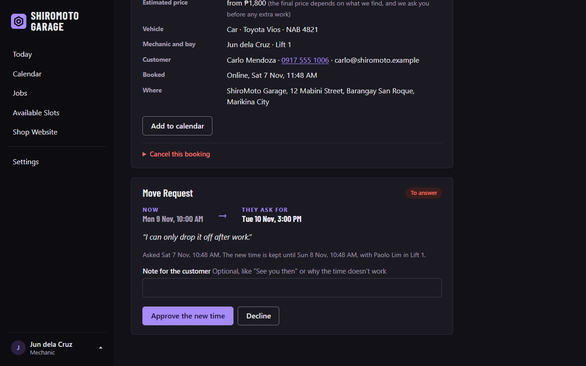 A mechanic answers, dark mode | 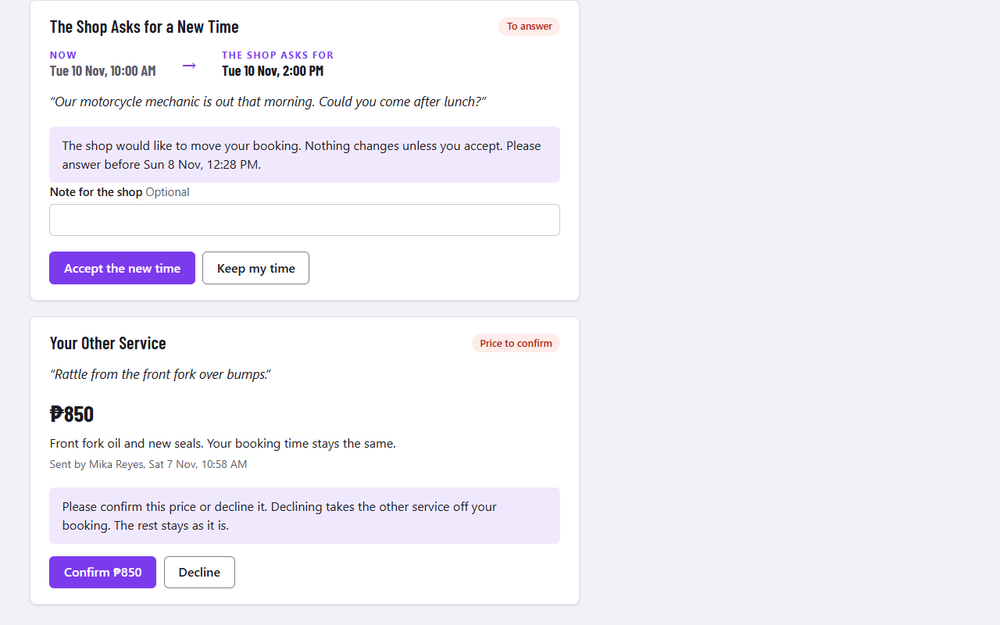 The shop asks for a new time |
| 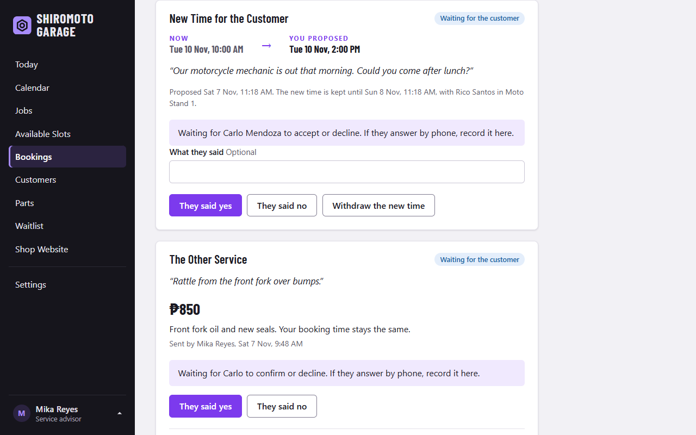 The desk waits for the customer | |
|  On a phone |  Free times on a phone |
| 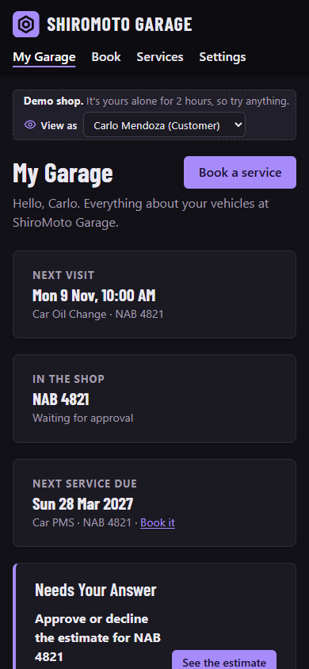 My Garage on a phone, dark mode | |
|  The phone app |  Make an account |

**The front desk and the workshop**

| | |
|---|---|
|  Today, dark mode |  Today, as a mechanic |
|  Calendar: a day, by bay |  Calendar: a week |
|  By mechanic, dark mode |  Available Slots, for staff |
|  Available Slots by bay, dark mode |  A booking, as staff see it |
| 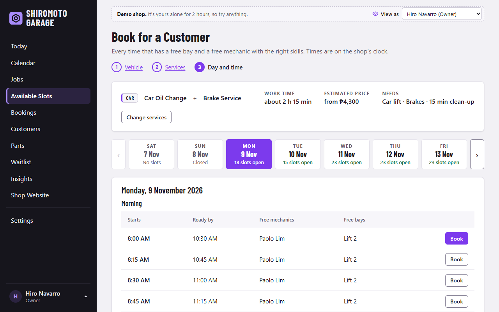 Booking for a walk-in or caller | |
|  Bookings |  A customer |
|  Jobs board |  A job and its estimate |
|  Parts and stock |  A vehicle's history |
|  The waitlist, for staff |  Insights |
|  Busiest hours, bay use and money | |

**Setting up the shop**

| | |
|---|---|
|  Settings |  Opening hours |
|  Closures and leave |  Bays |
|  Services and prices |  Staff |
|  A mechanic's skills and hours |  Log in |

All people and vehicles in these pictures are made up. They come from Try Demo.

## Tools

| Tool | What it is | What it does here |
|---|---|---|
| Python 3.13 | Language | The whole server |
| Flask | Web framework | Pages and forms |
| SQLAlchemy | Database library | The tables, as Python classes |
| Alembic | Migration tool | Changes the tables and keeps the data |
| SQLite | Database | Saves data on my computer and in tests |
| PostgreSQL (Neon) | Database | Saves data on the live site |
| zoneinfo, tzdata | Python's time zone tools | Manila time for every booking |
| Pillow | Image library | Makes check-in photos smaller, removes their GPS data, and draws the app's icons |
| pywebpush | Library | Sends push notifications to phones |
| itsdangerous | Library (comes with Flask) | Signs the links in notices |
| smtplib | Python's own library | Sends email through Gmail |
| pytest | Test tool | Checks that everything works, with real threads for the races, and without going online |
| Playwright | Browser tool | Takes the pictures for this page |
| Barlow Condensed | Font | Headings and the name. The two small files are inside the app. |
| HTML, CSS, JavaScript, SVG | Languages | The pages and the charts. They also work without JavaScript. |
| Service worker, Web Push | Browser features | The phone app: install, offline page, notifications |
| Render | Hosting platform | Runs the live site |
| GitHub Actions | Automation | The 15-minute timer for reminders and the waitlist |

## Run It on Your Computer

You need Python 3.13. Use these commands in PowerShell, in this folder.

1. Make the virtual environment and install the tools:

   ```
   python -m venv .venv
   .venv\Scripts\python -m pip install -r requirements.txt
   ```

2. Make the tables:

   ```
   .venv\Scripts\flask --app shiromoto upgrade-db
   ```

3. Make the shop and your owner login:

   ```
   .venv\Scripts\flask --app shiromoto create-owner you@example.com
   ```

4. Start the site, then open http://127.0.0.1:5008 and log in (or press Try Demo):

   ```
   .venv\Scripts\flask --app shiromoto run --debug --port 5008
   ```

Run the tests with:

```
.venv\Scripts\python -m pytest
```

## Put It Online

The site uses Render (it runs the program), Neon (it keeps the data) and GitHub (its timer). All three have a free plan.

1. **Neon:** make a project in the Singapore region. Copy the connection string. It starts with `postgresql://`.
2. **Render:** choose **New**, then **Blueprint**, then pick this repository. Render reads `render.yaml`. It makes `SECRET_KEY` and `TICK_KEY` by itself, and asks for the rest:
   - `DATABASE_URL`: the Neon string;
   - `BASE_URL`: the site's address, like `https://shiromoto-garage.onrender.com` (you can fill it in after the first deploy);
   - leave the email and push settings empty for now. The site works without them, and notices are shown in the app.
3. **Make the shop and your owner login.** Render's free plan has no Shell, so run it from your computer against Neon. Keep the string secret:

   ```
   $env:DATABASE_URL = "postgresql://..."
   .venv\Scripts\flask --app shiromoto create-owner you@example.com
   Remove-Item Env:DATABASE_URL
   ```

4. Open the site, log in, and finish the setup in **Settings**: phone and address, hours, bays, services, and invite your staff.
5. **The timer** (reminders and the waitlist): on GitHub, open the repository's **Settings → Secrets and variables → Actions** and add two secrets:
   - `TICK_URL`: `https://<your-site>.onrender.com/tasks/tick`;
   - `TICK_KEY`: copy it from Render (the service's **Environment** page).

   From then on, GitHub calls the site every 15 minutes.
6. **Email** (optional): turn on 2-Step Verification for the shop's Gmail, then make an **app password** (Google Account → Security → App passwords). On Render, set `MAIL_USERNAME` (the Gmail address), `MAIL_PASSWORD` (the 16 letters) and `MAIL_FROM` (like `ShiroMoto Garage <shop@gmail.com>`).
7. **Push notifications** (optional): run `.venv\Scripts\flask --app shiromoto make-vapid-keys` on your computer, and copy the two lines into Render as `VAPID_PUBLIC_KEY` and `VAPID_PRIVATE_KEY`.

Settings → **Email and Push** shows which of these are on. On the free plan, the site sleeps after 15 quiet minutes. The next visit (or the timer) wakes it up, and this takes about 30 to 50 seconds.

## Forgot Your Password?

The owner can set a new one from the command line:

```
.venv\Scripts\flask --app shiromoto set-password you@example.com
```
